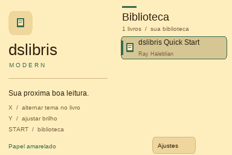
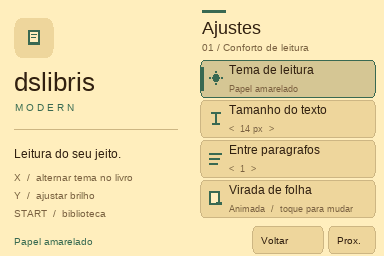

# DSLibris Modern

[](https://github.com/jaonasc/dslibris/actions/workflows/build.yml)

Leitor de EPUB para **Nintendo DS, DS Lite, DSi e DSi XL**, com uma interface renovada, temas de leitura e virada animada de páginas.

Esta variante parte do [DSLibris v1.5.2-2](https://github.com/rhaleblian/dslibris/tree/v1.5.2-2), de Ray Haleblian e colaboradores. A branch `modern-reader` contém esta versão; a `main` conserva a linha original do fork.

> **Pré-lançamento:** compilado e testado em emulador, com testes de memória e de regressão. A compatibilidade com seu carregador e o desempenho no console físico ainda precisam ser confirmados. Não há garantia de abrir qualquer EPUB existente.

## Download

**[Baixar DSLibris Modern v0.2.0](https://github.com/jaonasc/dslibris/releases/tag/modern-v0.2.0)**

O pré-lançamento contém:

- `DSLibris-Modern-v0.2.0.zip`: executável, fontes, livros de exemplo, instruções, capturas de tela e código-fonte.
- `dslibris-modern.nds`: somente o executável, para quem já tem as pastas `Font` e `Book`.
- `dslibris-modern-source-v0.2.0.zip`: código-fonte correspondente.
- `SHA256SUMS.txt`: hashes para conferir os arquivos baixados.

## Aparência

Capturas do programa em execução no DeSmuME, apresentadas na orientação de leitura:

| Biblioteca | Configurações |
| --- | --- |
|  |  |

## Recursos

- Biblioteca com cartões arredondados, ícones e quatro livros por tela.
- Botões maiores: itens de 38 pixels e navegação de 28 pixels.
- Configurações em português, distribuídas em duas páginas.
- Quatro temas: **claro, escuro, preto e papel amarelado**.
- Texto com antialiasing sobre a cor real do fundo.
- Virada de página 2D com deslizamento, borda e sombra, nos dois sentidos.
- Opção para desligar a animação e usar a troca instantânea.
- Escolha de fontes TrueType, tamanho do texto e espaçamento entre parágrafos.
- Marcadores e armazenamento da posição de leitura.
- Retomada do último livro, quando habilitada nas configurações.

O efeito de folha é uma aproximação 2D. Se não houver memória para seus buffers, a página é desenhada diretamente.

## Instalação no TWiLight Menu++

1. Baixe e extraia o pacote completo.
2. Copie `dslibris-modern.nds`, `Font` e `Book` para a **raiz do mesmo cartão** utilizado pelo carregador.
3. Coloque seus EPUBs na pasta `Book`.
4. Abra `dslibris-modern.nds` normalmente pelo TWiLight Menu++, inicialmente com as configurações padrão.

```text
raiz do cartão/
├── dslibris-modern.nds
├── Font/
│   ├── LiberationSans-Regular.ttf
│   ├── LiberationSerif-Regular.ttf
│   └── ...
└── Book/
    └── seu-livro.epub
```

As pastas precisam ficar na raiz; colocar o conjunto dentro de outra pasta não corresponde à instalação esperada por esta versão.

Se você já usa o DSLibris original, pode conservar `dslibris.nds` e os seus livros. O executável novo tem outro nome. Para outros carregadores e flashcarts, o acesso ao cartão depende do suporte a homebrew/DLDI disponível no seu equipamento. O `.nds` distribuído mantém o driver DLDI padrão.

Para o primeiro teste no aparelho, abra um livro, passe páginas, crie um marcador e confira a posição salva após reabrir. Compare também a leitura com a animação ligada e desligada.

## Controles

O DSLibris mantém a orientação de livro: **segure o console de lado**. Os direcionais acompanham a orientação configurada.

| Contexto | Controle | Ação |
| --- | --- | --- |
| Biblioteca | A ou toque no livro | Abrir |
| Biblioteca | SELECT | Abrir ajustes |
| Listas | L/R ou direcionais correspondentes | Percorrer itens |
| Ajustes | A ou toque | Alterar a opção |
| Tamanho/espaçamento | Metade esquerda/direita do botão | Diminuir/aumentar |
| Ajustes | Ant./Próx. | Alternar páginas de opções |
| Ajustes | B ou START | Voltar |
| Leitura | A/R ou direcional de avanço | Próxima página |
| Leitura | B/L ou direcional de retorno | Página anterior |
| Leitura | Toque nas metades da tela | Voltar/avançar, conforme orientação |
| Leitura | X | Alternar tema |
| Leitura | Y | Ajustar brilho nos modelos em que houver suporte |
| Leitura | SELECT | Adicionar/remover marcador |
| Leitura | START | Voltar à biblioteca |

## Preferências e recuperação

O programa cria `dslibris-modern.xml`. Se esse arquivo ainda não existir, tenta importar `dslibris.xml` da versão anterior sem sobrescrevê-lo.

As gravações passam por um arquivo `.tmp` e mantêm uma cópia anterior em `dslibris-modern.xml.bak`. Um XML principal incompleto pode ser recuperado pelo backup. O backup recuperado é preservado se a promoção do novo arquivo falhar. Esse mecanismo reduz o risco de perda; ele não garante proteção contra toda falha de energia ou de cartão.

## Correções de estabilidade

Esta revisão inclui:

- Liberação de páginas, buffers e recursos de EPUB ao fechar livros.
- Tratamento de ZIP/XML inválido e rejeição de livros sem páginas.
- Proteção contra excesso de tags aninhadas e transbordamento do buffer de página.
- Limites para posições, marcadores antigos e configurações importadas.
- Recuperação da fonte padrão se uma fonte salva foi removida.
- Validação de uma nova fonte antes de liberar a anterior.
- Escrita correta de nomes com `&`, aspas e outros caracteres especiais no XML.
- Tratamento de falha ao abrir o log.
- Correção do separador de caminho na abertura de XHTML legado.

O formato principal é EPUB. PDF e EPUBs com recursos avançados, DRM ou estruturas não suportadas pelo leitor original não fazem parte do suporte validado.

## Compilar

### Linux ou WSL com o SDK usado nesta versão

São necessários Python 3, `make` e as bibliotecas de execução exigidas pelo devkitARM. O script abaixo extrai o SDK de uma camada da imagem oficial **`devkitpro/devkitarm:20240511`** e verifica seu SHA-256; não requer instalar Docker.

```sh
git clone --branch modern-reader https://github.com/jaonasc/dslibris.git
cd dslibris
python3 scripts/fetch-sdk.py /tmp/dslibris-sdk
sh scripts/build.sh
```

O resultado é sempre `dslibris-modern.nds`, independentemente do nome da pasta clonada.

Se você já tem devkitPro, indique `DEVKITPRO` para usar sua instalação. As dependências de ligação estão no `Makefile`: libnds, libfat, FreeType, Expat, zlib, bzip2 e libpng. O SDK fixado acima é a referência usada na validação desta variante.

### Gerar o pacote

```sh
python3 scripts/package.py --output-dir dist
```

O pacote usa as fontes e os livros de exemplo incluídos neste repositório. A pasta `dist` recebe o ZIP completo, o ZIP de código-fonte e uma cópia do executável.

## Testes

Para os testes de host em Ubuntu/WSL, instale as dependências de desenvolvimento:

```sh
sudo apt-get update
sudo apt-get install g++ gcc python3 libexpat1-dev libfreetype-dev zlib1g-dev
sh scripts/verify-host.sh
```

Essa verificação usa AddressSanitizer/LeakSanitizer e UndefinedBehaviorSanitizer e cobre ciclo de vida das páginas, parser, EPUB danificado/vazio, abertura repetida, XML, recuperação de preferências, fontes e limites de posições.

Os testes visuais portáveis podem ser executados separadamente:

```sh
sh scripts/test.sh
```

Também foram executados cinco cenários no DeSmuME: animação ligada, desligada, orientação invertida, biblioteca vazia e livro danificado seguido de um válido. O executável final recebeu uma rodada adicional. Os scripts opcionais em `test/` e o relatório [VALIDACAO.md](VALIDACAO.md) registram o procedimento e suas limitações; o emulador não é necessário para usar o leitor.

O GitHub Actions compila a ROM com o SDK fixado e executa os testes de host. As capturas e os testes em emulador complementam essa verificação; ainda falta validação em hardware físico.

## Histórico e licença

- **v0.2.0 — 21/11/2026:** interface moderna, quatro temas, animação opcional e revisão de estabilidade.
- Base: **DSLibris v1.5.2-2**, commit `1f6154863d3a6553dac66d5ca17875324da4e32c`.
- Projeto original: [rhaleblian/dslibris](https://github.com/rhaleblian/dslibris).
- Fork: [jaonasc/dslibris](https://github.com/jaonasc/dslibris).

Código sob **GNU GPL versão 2 ou posterior**, conforme os avisos do projeto original. Os créditos e avisos dos componentes e recursos incluídos devem ser preservados. Veja [COPYING](COPYING).
